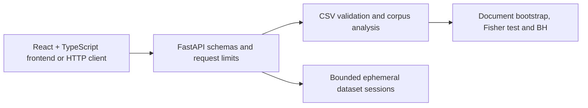

# Word Detective Pro

Explainable NLP and writing-pattern research platform. **Not an authorship detector.** Corpus labels, word frequencies, p-values and confidence intervals cannot establish who or what authored a text.

## Status and scope

The repository contains a React + TypeScript frontend, a FastAPI research backend, a bounded CSV dataset workflow, and a Word Explorer for comparing vocabulary across user-labelled groups. The application is a research tool, **not an authorship detector**. Labels and provenance are supplied by the uploader and are not independently verified.

Local verification completed: 77 backend tests passed, frontend tests passed (6 tests), frontend lint passed, and the production build passed. The local browser workflow was also exercised end to end: synthetic CSV upload, validation/activation, Word Explorer, word inspection, and JSON export. An intentionally invalid CSV was rejected while the previously active dataset remained usable. The maintainer reports that the latest GitHub Actions checks are green. These checks do not replace deployment validation, security review, or load testing.

No verified authorship dataset or validated authorship classifier is included. Synthetic examples are for application testing only and must not be treated as evidence of actual authorship.

**Known issue:** Browser-based Dataset Lab CSV validation can return `422 empty_dataset` even when the request payload appears present. The root cause is unconfirmed. Track the investigation in [issue #12](https://github.com/Tejas-Shivaji/word-detective-pro/issues/12). A successful direct API validation does not by itself confirm that the browser workflow is working.

## Architecture



| Path | Responsibility |
|---|---|
| `frontend/` | React + TypeScript user interface, tests, lint and production build |
| `backend/word_detective/core.py` | Typed corpus snapshots, strict CSV loading, preprocessing and statistics |
| `backend/word_detective/api.py` | HTTP schemas, errors, CORS, body limits and bearer dataset sessions |
| `backend/tests/test_core.py` | Constructed statistical and preprocessing fixtures |
| `backend/tests/test_api.py` | API contracts, validation, privacy and resource limits |
| `backend/pyproject.toml` | Direct dependency pins, packaging, pytest and Ruff configuration |
| `.gitignore` | Python, frontend, private-data and secret exclusions |
| `LICENSE` | MIT license |

Standard-library CSV and a documented Unicode regex replace unnecessary pandas/NLTK downloads for this bounded initial implementation. NumPy/SciPy provide statistical calculations. Python namespace packaging intentionally avoids adding unapproved `__init__.py` files.

## Local setup

Use Python **3.11 or 3.12**, Git, and Node.js compatible with the frontend toolchain. Clone the repository:

```bash
git clone https://github.com/Tejas-Shivaji/word-detective-pro.git
cd word-detective-pro
git switch main
```

### Windows with Git Bash

Create the backend virtual environment and install its dependencies:

```bash
cd ~/word-detective-pro/backend
py -3.12 -m venv .venv
source .venv/Scripts/activate
python -m pip install -e ".[dev]"
python -m pip check
```

Start the backend in **Terminal 1**:

```bash
cd ~/word-detective-pro/backend
source .venv/Scripts/activate
export WDP_CORS_ORIGINS="http://localhost:5173,http://127.0.0.1:5173"
python -m uvicorn word_detective.api:app --host 127.0.0.1 --port 8000 --workers 1 --no-access-log
```

Keep that terminal open. In **Terminal 2**, start the frontend:

```bash
cd ~/word-detective-pro/frontend
npm ci
npm run dev
```

Open `http://localhost:5173/` for the app, `http://127.0.0.1:8000/docs` for OpenAPI, and `http://127.0.0.1:8000/api/health` for liveness. If port 8000 is already occupied, check the existing process and health endpoint before starting another backend. The API requires one worker while dataset sessions are held in process memory. No keys, database or external LLM are required. Health reports no global configured dataset; sessions are client-specific.

On Windows PowerShell, activate the environment with `.venv\Scripts\Activate.ps1`. On POSIX systems, use `python3.12 -m venv .venv` and `. .venv/bin/activate`.

| Environment variable | Default |
|---|---|
| `WDP_MAX_BYTES` | `2000000`, all request bodies |
| `WDP_MAX_ROWS` | `1000` |
| `WDP_MAX_SESSIONS` | `4` per process |
| `WDP_TTL_SECONDS` | `900` |
| `WDP_REQUESTS_PER_MINUTE` | `120`, global per-process request budget |
| `WDP_CONCURRENT_ANALYSES` | `2`, concurrent analyses per process |
| `WDP_CORS_ORIGINS` | Empty; cross-origin access disabled |

For local React integration, set `WDP_CORS_ORIGINS=http://localhost:5173,http://127.0.0.1:5173`. Do not use wildcard origins. Additional typed `Settings`/`Limits` control 30 columns, 20,000 characters/document, 200,000 total tokens, 10,000 vocabulary items, two concurrent analyses and 120 research requests/minute globally.

## CSV contract and provenance

Supply your own permitted-use UTF-8 CSV, optionally with BOM. Required default columns are `text` and `label`, with exact labels `ai` and `human`. Configure column names and label mapping via upload query parameters. Both classes are required on import. Optional `category`, `source` and `subset` columns enable literal filters and per-class subgroup counts; these names are reserved.

Unique trimmed headers and equal row widths are required. Missing values in **any** column reject the whole upload; nothing is silently removed. Empty-token documents, unmapped labels, invalid encoding/quoting, oversized inputs and overlong tokens are rejected. A `subset` value is user metadata, **not proof of an independent test split**.

`source_origin` is required; optional `license_info`, `collection_version` and `limitations` record uploader assertions, not independently verified provenance. Unknown license defaults remain unknown. Dataset identity hashes input bytes; analysis identity additionally covers preprocessing, mappings, provenance, methodology and selected filters. MIT covers project code, not arbitrary uploaded datasets.

```bash
# Replace /path/to/permitted.csv; no dataset is bundled.
curl --fail -X POST \
  'http://127.0.0.1:8000/api/datasets/upload?source_origin=User-provided%20research%20corpus' \
  -H 'Content-Type: text/csv' --data-binary @/path/to/permitted.csv
```

Use the returned `dataset_token` as an `X-Dataset-Token` header, never in a URL. Treat it as a secret capability. For browser uploads, send the selected File directly as a raw `text/csv` body, **not FormData**.

| Endpoint | Result |
|---|---|
| `GET /api/health` | Liveness; no dataset required |
| `POST /api/datasets/validate` | Validation/quality summary; no session retained |
| `POST /api/datasets/upload` | Temporary token and corpus summary |
| `GET /api/dataset/summary` | Selected corpus sizes, duplicates, metadata counts and provenance |
| `GET /api/words` | Paginated absolute-difference ranking and support filters |
| `GET /api/words/{word}` | Word statistics and eligible bootstrap intervals |
| `POST /api/analyze-text` | Counts, selected terms and optional corpus comparison |

Responses are Pydantic-schema documented. Errors use `{ "error": { "code": "...", "message": "..." } }`. Text-analysis bodies use `text`, optional `terms`, and optional `options`. With a dataset, explicit mismatched preprocessing is rejected.

## Methodology and limitations

Tokenization applies NFKC, optional casefolding, curved-apostrophe normalization and Unicode alphanumeric token matching, preserving internal apostrophes. Punctuation separates tokens; decimals split at punctuation. Numeric-only tokens are removed by default; alphanumeric tokens remain. Stop words are explicitly supplied, not a hidden language list. No stemming or lemmatization. Unicode regex segmentation is not reliable word segmentation for every language.

For group g, token probability = word occurrences / total analysis tokens; frequency = 1000 times that probability. Prevalence = documents containing the word / documents in the group. Signed difference is AI-labelled minus human-labelled frequency; ranking uses its absolute value. Ratios are unsmoothed and null when the human denominator is zero or either token total is zero.

Inference requires at least 10 documents per group and no normalized-text duplicates; these are conservative eligibility rules, not guarantees. Prevalence uses Wilson intervals and two-sided Fisher exact tests. BH adjusts over the entire selected vocabulary **before display/support filtering**. Its FDR interpretation assumes independence or suitable positive dependence; correlated words and exploratory subgroup selection complicate that interpretation.

Frequency intervals resample whole documents independently within groups and recompute pooled token frequencies: 500 replicates, seed 1729, marginal 95% percentile intervals. Word detail accepts 100–1000 replicates. Both groups need at least five supporting documents and nonconstant document rates; otherwise intervals are withheld. Absence is not falsely assigned zero uncertainty. Intervals are neither simultaneous nor selection-adjusted.

Duplicates use NFKC/casefold/whitespace-normalized text identity. Counts retain duplicates but inference is disabled; conflicting labels are reported. Near-duplicates and author/prompt/source clustering are not resolved. Metadata counts flag groups with fewer than ten documents/class. Missing source metadata prevents source-level bias analysis.

Small p-values do not imply practical importance, generalization or authorship. Topic, source, prompt, editing, paraphrasing, language proficiency, sampling bias and dataset shift can dominate patterns. Sentence count is a punctuation heuristic; vocabulary diversity is unique analysis tokens / analysis tokens and depends on length. No classifier or verified authorship probability exists in this slice.

## Privacy and deployment boundaries

Raw CSV/text is processed transiently and never intentionally written to disk. Normalized tokens remain sensitive: they and selected metadata stay in bounded process memory. Sessions become inaccessible after TTL; expired entries are physically pruned on the next store access, not by a background timer. Restart clears memory. This is not forensic secure erasure. Validation and text analysis do not create sessions.

No client filenames are used; content is never executed. Validation errors omit input echoes. Disable body/header logging at proxies too. A global budget is not fair per-user rate limiting; request buffering and slow clients still need ingress controls. Before any public deployment, add authentication, TLS, proxy byte/time/concurrency limits, dependency/security review and load testing. Use one worker until shared session storage is deliberately implemented. **Do not deploy this branch yet.**

## Verification and troubleshooting

Run from `backend/` after activating the virtual environment:

```bash
python -m pip check
python -m ruff check word_detective tests
python -m pytest -q
python -m build
```

The backend suite passed locally (77 tests). The frontend suite passed locally (6 tests), and frontend lint and production build passed. Tests cover Unicode, counts, zero denominators, known statistical values, resampling reproducibility, duplicates, filters, schemas, malformed/oversized CSV, chunked bodies, text validation, CORS, session isolation/expiry, rate limits and safe errors. Local browser checks covered valid CSV upload through JSON export and rejection of an invalid-header CSV. These checks do not cover production deployment, classifier evaluation, stress/security audits, or public-facing operational safeguards. Direct dependencies are pinned; transitive dependencies are not locked.

A 404 dataset error means missing/expired handle; re-upload. A 415 means wrong upload content type. A 413 means configured limits were exceeded. A 429 is the global request budget. A 503 indicates compute/session capacity. Do not weaken safety limits without resource testing.

## Automated verification

GitHub Actions is configured in `.github/workflows/ci.yml`. It runs backend tests, frontend tests, and frontend lint plus production build. The maintainer reports that the latest Actions run is green.

Passing CI and local checks do not establish production deployment readiness. Security review, load testing, authentication, TLS and deployment safeguards remain separate tasks.
