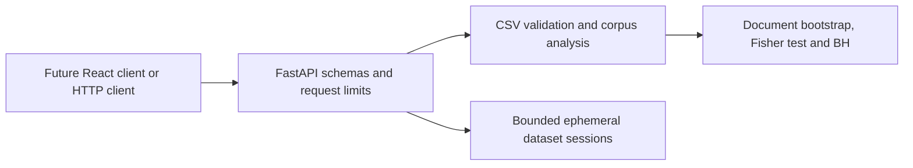

# Word Detective Pro

Explainable NLP and writing-pattern research platform. **Not an authorship detector.** Corpus labels, word frequencies, p-values and confidence intervals cannot establish who or what authored a text.

## Status and scope

This feature branch implements the initial Python research backend, not the complete dashboard. No original dataset was available. No demonstration corpus, classifier, model score, frontend, deployment or held-out evaluation is claimed. Tests contain explicitly constructed fixtures only.

Code has been committed, but **lint, tests, package installation, dependency resolution and builds have not been executed in the authoring environment**, which has no shell. The GitHub connector failed to write `.github/workflows/ci.yml`; readback did not find it and no Actions runs were reported. The complete intended workflow is preserved below for installation at that approved path. An initial incomplete API-test commit was corrected without rewriting history.

## Architecture



| Path | Responsibility |
|---|---|
| `backend/word_detective/core.py` | Typed corpus snapshots, strict CSV loading, preprocessing and statistics |
| `backend/word_detective/api.py` | HTTP schemas, errors, CORS, body limits and bearer dataset sessions |
| `backend/tests/test_core.py` | Constructed statistical and preprocessing fixtures |
| `backend/tests/test_api.py` | API contracts, validation, privacy and resource limits |
| `backend/pyproject.toml` | Direct dependency pins, packaging, pytest and Ruff configuration |
| `.gitignore` | Existing Python rules plus frontend, private-data and secret exclusions |
| `LICENSE` | Existing MIT license, copyright 2026 Tejas G; unchanged |

Standard-library CSV and a documented Unicode regex replace unnecessary pandas/NLTK downloads for this bounded initial implementation. NumPy/SciPy provide statistical calculations. Python namespace packaging intentionally avoids adding unapproved `__init__.py` files.

## Local setup

Use Python **3.11 or 3.12**, Git, and a private clone. POSIX commands:

```bash
git clone https://github.com/Tejas-Shivaji/word-detective-pro.git
cd word-detective-pro
git switch feature/research-core
cd backend
python3.12 -m venv .venv
. .venv/bin/activate
python -m pip install -e '.[dev]'
python -m pip check
python -m uvicorn word_detective.api:app --host 127.0.0.1 --port 8000 --workers 1 --no-access-log
```

On Windows, use `py -3.12 -m venv .venv` and `.venv\Scripts\Activate.ps1`. Open `http://127.0.0.1:8000/docs` for OpenAPI and `/api/health` for liveness. No keys, database or external LLM are required. Health reports no global configured dataset; sessions are client-specific.

| Environment variable | Default |
|---|---|
| `WDP_MAX_BYTES` | `2000000`, all request bodies |
| `WDP_MAX_ROWS` | `1000` |
| `WDP_MAX_SESSIONS` | `4` per process |
| `WDP_TTL_SECONDS` | `900` |
| `WDP_CORS_ORIGINS` | Empty; cross-origin access disabled |

For future local React integration, explicitly set `WDP_CORS_ORIGINS=http://localhost:5173`. No wildcard origins. Additional typed `Settings`/`Limits` control 30 columns, 20,000 characters/document, 200,000 total tokens, 10,000 vocabulary items, two concurrent analyses and 120 research requests/minute globally.

## CSV contract and provenance

Supply your own permitted-use UTF-8 CSV, optionally with BOM. Required default columns are `text` and `label`, with exact labels `ai` and `human`. Configure column names and label mapping via upload query parameters. Both classes are required on import. Optional `category`, `source` and `subset` columns enable literal filters and per-class subgroup counts; these names are reserved.

Unique trimmed headers and equal row widths are required. Missing values in **any** column reject the whole upload; nothing is silently removed. Empty-token documents, unmapped labels, invalid encoding/quoting, oversized inputs and overlong tokens are rejected. A `subset` value is user metadata, **not proof of an independent test split**.

`source_origin` is required; optional `license_info`, `collection_version` and `limitations` record uploader assertions, not independently verified provenance. Unknown license defaults remain unknown. Dataset identity hashes input bytes; analysis identity additionally covers preprocessing, mappings, provenance, methodology and selected filters. MIT covers project code, not arbitrary uploaded datasets.

```bash
# Replace /path/to/permitted.csv; no dataset is bundled.
curl --fail -X POST \
  'http://127.0.0.1:8000/api/datasets/upload?source_origin=User-provided%20research%20corpus' \
  -H 'Content-Type: text/csv' --data-binary @/path/to/permitted.csv
```

Use the returned `dataset_token` as an `X-Dataset-Token` header, never in a URL. Treat it as a secret capability. For browser uploads, send the selected File directly as a raw `text/csv` body, **not FormData**.

| Endpoint | Result |
|---|---|
| `GET /api/health` | Liveness; no dataset required |
| `POST /api/datasets/validate` | Validation/quality summary; no session retained |
| `POST /api/datasets/upload` | Temporary token and corpus summary |
| `GET /api/dataset/summary` | Selected corpus sizes, duplicates, metadata counts and provenance |
| `GET /api/words` | Paginated absolute-difference ranking and support filters |
| `GET /api/words/{word}` | Word statistics and eligible bootstrap intervals |
| `POST /api/analyze-text` | Counts, selected terms and optional corpus comparison |

Responses are Pydantic-schema documented. Errors use `{ "error": { "code": "...", "message": "..." } }`. Text-analysis bodies use `text`, optional `terms`, and optional `options`. With a dataset, explicit mismatched preprocessing is rejected.

## Methodology and limitations

Tokenization applies NFKC, optional casefolding, curved-apostrophe normalization and Unicode alphanumeric token matching, preserving internal apostrophes. Punctuation separates tokens; decimals split at punctuation. Numeric-only tokens are removed by default; alphanumeric tokens remain. Stop words are explicitly supplied, not a hidden language list. No stemming or lemmatization. Unicode regex segmentation is not reliable word segmentation for every language.

For group g, token probability = word occurrences / total analysis tokens; frequency = 1000 times that probability. Prevalence = documents containing the word / documents in the group. Signed difference is AI-labelled minus human-labelled frequency; ranking uses its absolute value. Ratios are unsmoothed and null when the human denominator is zero or either token total is zero.

Inference requires at least 10 documents per group and no normalized-text duplicates; these are conservative eligibility rules, not guarantees. Prevalence uses Wilson intervals and two-sided Fisher exact tests. BH adjusts over the entire selected vocabulary **before display/support filtering**. Its FDR interpretation assumes independence or suitable positive dependence; correlated words and exploratory subgroup selection complicate that interpretation.

Frequency intervals resample whole documents independently within groups and recompute pooled token frequencies: 500 replicates, seed 1729, marginal 95% percentile intervals. Word detail accepts 100–1000 replicates. Both groups need at least five supporting documents and nonconstant document rates; otherwise intervals are withheld. Absence is not falsely assigned zero uncertainty. Intervals are neither simultaneous nor selection-adjusted.

Duplicates use NFKC/casefold/whitespace-normalized text identity. Counts retain duplicates but inference is disabled; conflicting labels are reported. Near-duplicates and author/prompt/source clustering are not resolved. Metadata counts flag groups with fewer than ten documents/class. Missing source metadata prevents source-level bias analysis.

Small p-values do not imply practical importance, generalization or authorship. Topic, source, prompt, editing, paraphrasing, language proficiency, sampling bias and dataset shift can dominate patterns. Sentence count is a punctuation heuristic; vocabulary diversity is unique analysis tokens / analysis tokens and depends on length. No classifier or verified authorship probability exists in this slice.

## Privacy and deployment boundaries

Raw CSV/text is processed transiently and never intentionally written to disk. Normalized tokens remain sensitive: they and selected metadata stay in bounded process memory. Sessions become inaccessible after TTL; expired entries are physically pruned on the next store access, not by a background timer. Restart clears memory. This is not forensic secure erasure. Validation and text analysis do not create sessions.

No client filenames are used; content is never executed. Validation errors omit input echoes. Disable body/header logging at proxies too. A global budget is not fair per-user rate limiting; request buffering and slow clients still need ingress controls. Before any public deployment, add authentication, TLS, proxy byte/time/concurrency limits, dependency/security review and load testing. Use one worker until shared session storage is deliberately implemented. **Do not deploy this branch yet.**

## Verification and troubleshooting

```bash
cd backend  # from repository root, after activating the virtual environment
python -m pip check
python -m ruff check word_detective tests
python -m pytest -q --junitxml=test-results.xml
python -m build
```

No pass count is asserted. Tests cover Unicode, counts, zero denominators, known statistical values, resampling reproducibility, duplicates, filters, schemas, malformed/oversized CSV, chunked bodies, text validation, CORS, session isolation/expiry, rate limits and safe errors. Untested: frontend, deployed workflows, classifier evaluation, stress/security audits and dependency installation until these commands actually run. Direct dependencies are pinned; transitive dependencies are not locked. CI captures resolved versions for review.

A 404 dataset error means missing/expired handle; re-upload. A 415 means wrong upload content type. A 413 means configured limits were exceeded. A 429 is the global request budget. A 503 indicates compute/session capacity. Do not weaken safety limits without resource testing.

## GitHub Actions installation (connector write blocked)

The connector returned an unspecified failure for the workflow write, not a confirmed permission diagnosis. Ordinary commits succeeded. If authentication uses classic OAuth/PAT, verify `workflow` scope as well as private-repository access; for fine-grained credentials verify repository **Contents: write** and **Workflows: write**. Also check repository Actions policy. Do not paste credentials into chat or files.

Create `.github/workflows/ci.yml` **on `feature/research-core`**, using exactly the YAML below, and commit with `ci: run backend lint and automated tests`. This is the only approved file not yet committed. The next push should run the matrix. Inspect each run before claiming success. No merge or deployment is included.

```yaml
name: Backend verification
on:
  push:
    branches: [main, 'feature/research-core']
  pull_request:
    branches: [main]
  workflow_dispatch:
permissions:
  contents: read
concurrency:
  group: backend-${{ github.ref }}
  cancel-in-progress: true
jobs:
  backend:
    name: Python ${{ matrix.python }} lint, tests and build
    runs-on: ubuntu-24.04
    timeout-minutes: 12
    strategy:
      fail-fast: false
      matrix:
        python: ['3.11', '3.12']
    defaults:
      run:
        working-directory: backend
    steps:
      - uses: actions/checkout@v4
        with:
          persist-credentials: false
      - uses: actions/setup-python@v5
        with:
          python-version: ${{ matrix.python }}
          cache: pip
          cache-dependency-path: backend/pyproject.toml
      - name: Install pinned direct dependencies
        run: |
          python -m pip install --disable-pip-version-check -e '.[dev]'
          python -m pip check
      - name: Lint
        run: python -m ruff check word_detective tests
      - name: Unit and HTTP contract tests
        run: python -m pytest -q --junitxml=test-results.xml
      - name: Build backend wheel and source distribution
        run: python -m build
      - name: Verify installed wheel and live health endpoint
        run: |
          python -m venv /tmp/wdp-wheel-check
          /tmp/wdp-wheel-check/bin/python -m pip install dist/*.whl
          cd /tmp
          /tmp/wdp-wheel-check/bin/python -m uvicorn word_detective.api:app --host 127.0.0.1 --port 8765 --no-access-log &
          SERVER_PID=$!
          trap 'kill "$SERVER_PID"' EXIT
          for attempt in $(seq 1 30); do
            if curl --fail --silent http://127.0.0.1:8765/api/health > /tmp/wdp-health.json; then
              python -c 'import json; assert json.load(open("/tmp/wdp-health.json"))["status"] == "ok"'
              exit 0
            fi
            sleep 1
          done
          echo 'Health check did not become ready'
          exit 1
      - name: Record resolved dependencies
        if: always()
        run: python -m pip freeze > resolved-dependencies.txt
      - name: Preserve verification evidence
        if: always()
        uses: actions/upload-artifact@v4
        with:
          name: backend-evidence-python-${{ matrix.python }}
          retention-days: 7
          if-no-files-found: warn
          path: |
            backend/test-results.xml
            backend/resolved-dependencies.txt
            backend/dist/*
```
